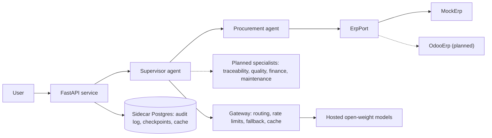

# agentic-ops

[](https://github.com/0checkMate/agentic-ops/actions/workflows/ci.yml)

ERP-agnostic agentic operations platform. Odoo is the first adapter. A supervisor agent routes
questions to specialist agents that read ERP data and prepare drafts. A human confirms every write.
The demo domain is food and beverage manufacturing, on synthetic data.

## Architecture



## Status

| Area | State |
|---|---|
| Model gateway (aliases, per-provider rate limits, fallback, Postgres cache, audit) | Built |
| `ErpPort` with `MockErp` and a shared contract test suite | Built |
| Supervisor and procurement agent (tool calling, audited) | Built |
| API: `/health`, `/ready`, `/chat` with persistent LangGraph threads | Built |
| Synthetic F&B dataset, `mock_erp` schema loader, read-only SQL role | Built |
| Tool-calling benchmark harness and a first procurement run (`benchmarks/`) | Built |
| CI: ruff, strict mypy, unit, contract and integration tests, container smoke test | Built |
| Human-in-the-loop confirmation (interrupt and resume) and review UI | In progress |
| Odoo adapter | Planned |
| Traceability, quality and CAPA with RAG, finance, maintenance | Planned |

## Engineering decisions

- **Sidecar design:** the agent service owns its own Postgres and never writes to ERP tables.
  This keeps the ERP safe and the platform portable.
- **Ports and adapters:** agents depend on `ErpPort`, not on a vendor. One contract suite runs
  against every adapter, so a new adapter is proven by tests, not by trust.
- **Human confirms every write:** agents create drafts only, and `ErpPort` has no confirm method.
  Confirmation is a separate human action.
- **Hand-built gateway:** per-provider limits, fallback, caching and an audit trail on free-tier
  models. The choice is documented in `docs/adr/`.
- **Audit by thread:** every route decision, tool call and tool result is recorded per thread ID.
- **Strict quality gate:** ruff and mypy in strict mode over source and tests, enforced in CI.

## Run the checks

```bash
python -m venv .venv && source .venv/bin/activate
pip install -c requirements.txt '.[dev]'
ruff format . && ruff check --fix . && mypy && pytest
```

Integration tests need a Postgres with the pgvector extension and `AGENTIC_TEST_DATABASE_URL`.
Without it they skip. Secrets live in a git-ignored `.env`. `.env.example` lists variable names only.

## Container

```bash
docker build -t agentic-ops .
```

The image runs as a non-root user and reads `PORT` and `AGENTIC_DATABASE_URL` from the environment.
Migrations run separately, never at app startup. CI builds the image and checks `/ready` and
`/health` against a Postgres service.